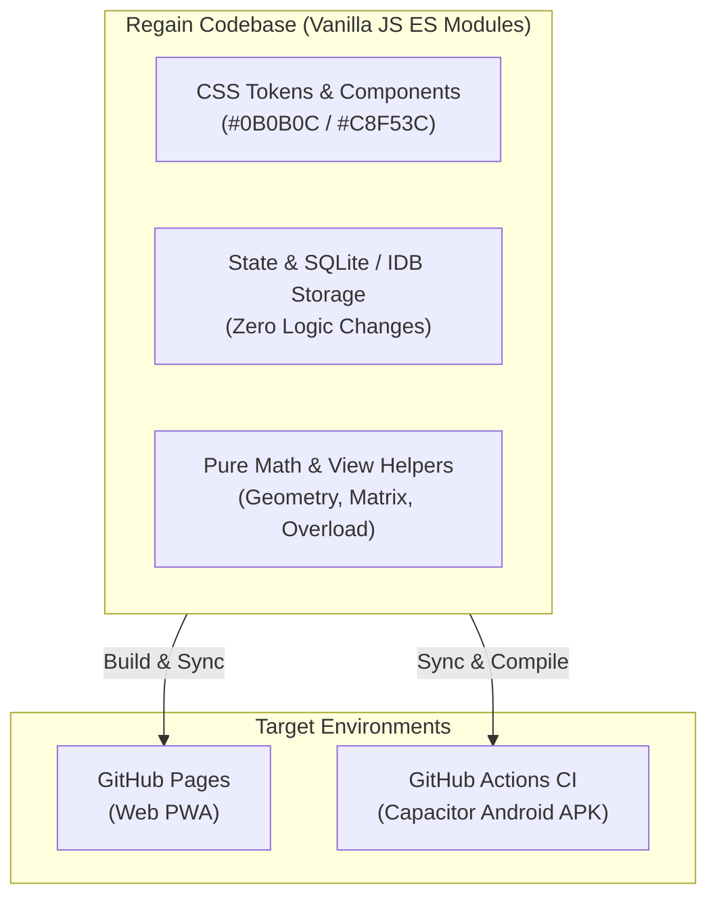
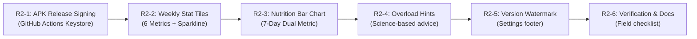

# Regain — Complete UI Upgrade Master Manual (Round 1 & Round 2)

**Document Version**: 2.0.0  
**Project**: Regain — Progressive Web App & Native Android APK  
**Architectural Scope**: Complete Design System Modernization, Charting Engines, Gesture Routing, and Stable CI/CD Release Pipeline.  

---

## 1. Executive Summary & Core Context

Regain is a zero-dependency, offline-first personal fitness application built with vanilla modern JavaScript ES Modules. It operates seamlessly in two environments from a single unified codebase:
1. **Web App (PWA)**: Hosted on GitHub Pages, storing live test data in client-side storage (`localStorage` and `IndexedDB`).
2. **Native Android App**: Powered by Capacitor 8, rendered inside an Android System WebView (Chromium 100+), built via automated GitHub Actions CI.

---

## 2. CI/CD & Android Packaging Analysis

### 2.1 Workflow Audit (`.github/workflows/build-apk.yml`)
- **Workflow Name**: `Build Android APK`
- **Triggers**:
  - `push` to branch `main`.
  - `workflow_dispatch` (manual one-click trigger in GitHub Actions UI).
- **Environment**: `ubuntu-latest`, Node.js 22, Temurin JDK 21, Android SDK Platform 36 & Build-Tools 36.0.0.
- **APK Output**:
  - Saved as a GitHub Actions Artifact: `regain-debug-apk` (containing `app-debug.apk`).
  - Retention: 30 days.
- **Current Signing**: Default Android Debug key generated dynamically during `./gradlew assembleDebug`.
- **GitHub Pages Configuration**:
  - Deployed exclusively from the default branch (`main`).
  - Feature branches (`ui-round-1`, `ui-round-2`) **do not** trigger web app deployments, preserving production data safety.

---

## 3. Strict Engineering Guardrails (Hard Rules)

All development must adhere strictly to these non-negotiable rules:

| Rule Category | Requirement | Critical Safety Rationale |
| :--- | :--- | :--- |
| **Logic Integrity** | Zero edits to storage, schema, state stores, e1RM math, timers, or catch-up logic. | Protects existing user workout data and history from corruption. |
| **Pure Helpers** | Derived display math files must be pure functions with zero DOM, zero storage calls, and no internal `Date.now()`. | Ensures deterministic behavior and 100% testability. |
| **Code Length** | Every JavaScript file strictly $\le 400$ lines. | Maintains codebase maintainability and modular structure. |
| **Gesture Safety** | Every horizontally interactive element must declare `data-gesture-owner` and `touch-action: pan-y`. | Prevents horizontal swipes from interfering with global tab navigation. |
| **Logger Guard** | Never re-render the Gym exercise list on timer ticks or animation updates. | Prevents loss of active input focus during workout logging. |
| **Date Safety** | Date keys (`YYYY-MM-DD`) must be constructed strictly using local date methods (`getFullYear()`, `getMonth()`, `getDate()`). Never use `toISOString()` or add `86,400,000 ms`. | Eliminates timezone day-shifting errors. |
| **CSS Safety** | No `:has()`, `@container`, `dvh`/`svh`, CSS nesting, or View Transitions API. | Ensures flawless compatibility with Android WebView Chromium 100+. |

---

## 4. UI Upgrade Round 1 — Foundations & Core Polish

### Item 1: Segmented Control Component (`js/ui/segmented.js`)
- **Visual Design**: 48px height pill container with surface track (`#1C1C1F`) and smooth gliding off-white thumb (`#F2F2EE`).
- **Interaction**: Keyboard arrow navigation (ArrowLeft/ArrowRight, Home/End) with roving tabindex.
- **Locations**:
  1. History tab: "Past Weeks / Past Months".
  2. Lifts tab: Metric switch ("Est. 1RM" / "Top set" / "Volume").

### Item 2: Line Chart & Monotone Geometry (`js/ui/chartGeometry.js` & `lineChart.js`)
- **Mathematical Foundation**: Fritsch-Carlson Monotone Cubic Spline to guarantee the curve never exceeds local peaks or dips below data points.
- **Rendering**: Clean SVG vector curve (2.5px width) with soft gradient area fill.
- **Interaction**: Pointer drag scrub showing floating readout pill with selection haptics.
- **Locations**: Progress > Bodyweight chart and Progress > Lifts chart.

### Item 3: Lifts Tab Upgrade (`js/view/liftStats.js`)
- **Metric Toggle**: Switch between **Est. 1RM**, **Top Set**, and **Volume**.
- **Personal Bests**: 3-column card displaying Heaviest Set, Best 1RM, and Peak Volume with dates.
- **Recent Sessions Feed**: Chronological list of past workouts with set counts, volume, and lime PR chips.

### Item 4: Numbered History Calendar Grid (`js/view/calendarGrid.js`)
- **Grid Layout**: 7-column Monday-first calendar grid with fixed 6-row container height.
- **States**: Trained (lime fill), Planned (lime ring), Skipped (dark ring), Rest (surface fill), Today (white outline).
- **Day Sheet Integration**: Tapping past dates reveals workout and nutrition summaries.

### Item 5: Today Week Strip Day Circles
- Replaces legacy dot strip with 7 accessible circular status chips with shape-and-color encoding (check icon, rings, dot, outline).

### Item 6: Sticky Gym Session Summary Bar
- Sticky bar showing active workout name, progress tracker, unified session stopwatch pill, and Start/Finish actions.
- Highlights active exercise with `.is-current` without re-rendering the logger.

---

## 5. UI Upgrade Round 2 — Master Instructions

### Task R2-1: Stable APK Signing & Versioning
- Configures persistent Gradle release signing in `.github/workflows/build-apk.yml` and `android/app/build.gradle`.
- Generates `versionCode = BASE + github.run_number` to guarantee seamless over-the-air updates without data wiping.
- Secrets required: `ANDROID_KEYSTORE_BASE64`, `ANDROID_KEYSTORE_PASSWORD`, `ANDROID_KEY_ALIAS`, `ANDROID_KEY_PASSWORD`.

### Task R2-2: Weekly Stat Tiles (Progress > Body)
- 6 responsive metric tiles: Weight (7-day average), Rate (kg/wk), Calories, Protein, Workouts, and Sets.
- Built-in pure monotone cubic sparkline engine (`js/ui/sparkline.js`).

### Task R2-3: 7-Day Nutrition Bar Chart
- Dual-metric bar chart (Calories / Protein) with dynamic nice-number scaling (`js/ui/barGeometry.js`).
- Distinguishes rest-day vs. training-day targets, marking compliant days with lime accent.

### Task R2-4: Progressive Overload Recommendations
- Pure advisory progression engine (`js/lib/progression.js`).
- Evaluates previous completed sets against prescribed rep range and RIR:
  - All sets hit top reps cleanly $\rightarrow$ Recommend weight increase ($+2.5\text{ kg}$ or $+5\text{ kg}$).
  - All sets hit top reps to failure ($\text{RIR} = 0$) $\rightarrow$ Recommend holding weight.
  - Working cleanly within range $\rightarrow$ Recommend $+1\text{ rep}$.

### Task R2-5: Version Label
- Displays `Regain · v2.0.0` at the footer of Settings.
- Bumps service worker cache key in `sw.js`.

---

## 6. Manual Device Verification Checklist (For the Owner)

- [ ] **APK Installation**: Verify app installs over previous version without requiring uninstallation.
- [ ] **Today Screen**: Verify 7 day circles show correct status (Done, Planned, Rest, Skipped, Today outline).
- [ ] **Gym Logger Stress Test**:
  - [ ] Start a workout.
  - [ ] Log Set 1, then immediately log Set 2 and Set 3 while rest timer ticks.
  - [ ] Confirm no layout jitter and active text input retains focus.
  - [ ] Verify progression hint chip shows expected target and toggles explanation.
- [ ] **Lifts Tab**:
  - [ ] Switch between Est. 1RM, Top set, and Volume.
  - [ ] Drag/scrub the chart line and verify floating readout pill.
  - [ ] Verify Personal Bests card matches all-time records.
- [ ] **History Screen**:
  - [ ] Switch months and verify smooth 200ms slide transition without layout jump.
  - [ ] Tap past trained and skipped days to verify bottom sheet details.
  - [ ] Verify day numbers match day of week correctly (Monday-first).
- [ ] **Settings Screen**:
  - [ ] Verify `Regain · v2.0.0` is centered at bottom.
  - [ ] Export backup to verify data serialization remains 100% intact.
